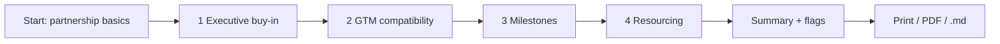

# Partnership workshop worksheet

Status: implemented (2026-11-21).

## Original prompt

> We're going to create another interactive experience. This one is for biulding a workshop to create partnerships or alliances across companies.
>
> ## Four components:
>
> There are four components required for any alliance:
> 1. Executive buy in - Typically represented by one to three named executives on each side (preferrably 1)
> 2. Compatible Go-to-Market = Compatible and non-competing patterns including complementary or lack of sales competition, compatible sales compensation models, industry types, marketing messaging (target personas, channels), regions, and similar GTM considerations. The important thing is to avoid situations where there's either obvious conflict or complete disassociation.
> 3. Compatible and agreed upon milestones for joint releases or product features - Including compatibility releases, integration milestones, new products, new format introduction, moving an existing product from one company onto the tech of the other, or bundling (which is often very complicated).
> 4. Committed resourcing - Without resource commitments, milestones won't be met.
>
> ## App experience:
>
> Create another 1-page web app that captures these facets of establishing a partnership through some kind of interactive worksheet. The styles should match the other styles in PM Tools, preferrably using W3CSS and the shared CSS and JS resources. The user should be able to download as PDF or MD or print out their worksheet at the end of the process.

## Overview

New single-page PM Tools app, `partnership-workshop.html`. It walks a cross-company team through the four alliance components (executive buy-in, compatible go-to-market, agreed milestones, committed resourcing) and ends with a summary of readiness flags that can be printed, saved as PDF, or downloaded as Markdown.

## Assumptions (defaults used)
- **PDF:** a print stylesheet plus `window.print()`. One "Print / Save as PDF" button covers both, so no PDF library is needed.
- **Shared JS:** create `scripts/pm-tools.js` with `escapeHtml`, `downloadFile(name, text, type)` and `copyText`. Only the new app uses it for now; the existing tools stay unchanged.
- **Assessment:** each component gets a light readiness status (Ready, At risk, Missing) plus plain-language flags. There is no numeric scoring.
- **Persistence:** nothing is stored; everything stays in the browser, like the other tools.

## Flow

Reuses the wizard shell from `product-elevator-pitch.html`: header with `home-link`, `.progress-outer`, `.trail`, `w3-card` steps, `.big-btn` Continue, plus Back and Start over. Visited steps can be reopened from the trail or from the Edit buttons on the summary.

## Step content
- **Start:** partnership name, Company A, Company B, workshop date, and participants (optional). Name and both companies are required to continue.
- **1. Executive buy-in:** for each company, 1 to 3 executive rows (name, title, role in the alliance). Flags: no executive on a side (Missing), more than 1 per side (note that a single sponsor is preferred).
- **2. GTM compatibility:** sales motion and competition, sales compensation, industries, target personas, marketing channels and messaging, regions, and pricing/licensing model. Each gets a rating (Complementary / Neutral / Conflict / Disconnected) and notes. Flags: nothing assessed (Missing); not discussed, Conflict, or Disconnected dimensions (At risk).
- **3. Milestones:** repeatable rows with type (compatibility release, integration, new product, new format, move product onto partner tech, bundle), description, target date, and owner per company. Milestones without a description are ignored. Flags: none defined (Missing), no date or missing owner (At risk), and a bundle complexity note.
- **4. Resourcing:** for each milestone, per company: lead, people/FTE, budget, and status (Committed / Proposed / None). Flags: any side not Committed (At risk); no milestone committed by both sides (Missing).
- **Summary:** header block, overall "N of 4 components ready", one status card per component with flags, full worksheet tables, and actions: Print / Save as PDF, Download .md, Copy Markdown, Edit per section, Start over (with confirmation).

## Files
- **New** `partnership-workshop.html`: W3.CSS and `styles/pm-tools.css`, inline step model, render functions, `buildMarkdown()`, page-local styles, and `@media print` that hides the header, trail, buttons and footer.
- **New** `scripts/pm-tools.js`: `PMTools.escapeHtml`, `PMTools.downloadFile`, `PMTools.copyText`.
- **Edit** `pm-tools.html`: added the "Partnership Workshop" card.

## Verification
- Stepped through every step in a browser with test data; answers persisted across navigation.
- Each flag fired as expected: missing executive, multiple executives, Conflict, Disconnected, not discussed, missing date and owner, bundle note, proposed and uncommitted resources.
- The Markdown output contains every section, and pipes in notes are escaped.
- In print mode the header, trail, buttons and footer are hidden.
